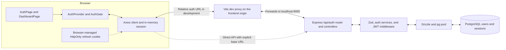
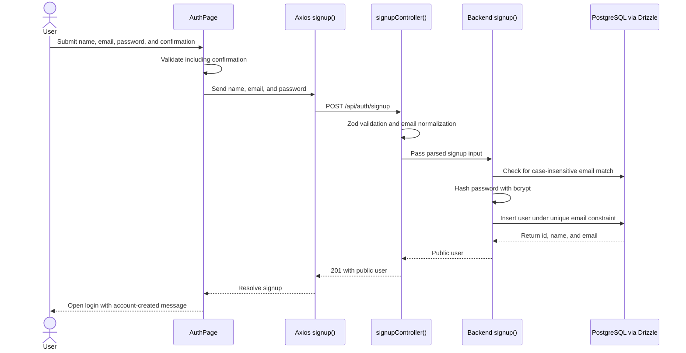
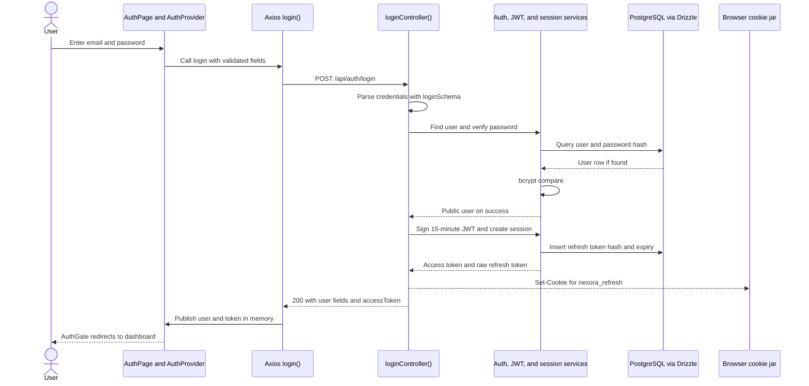
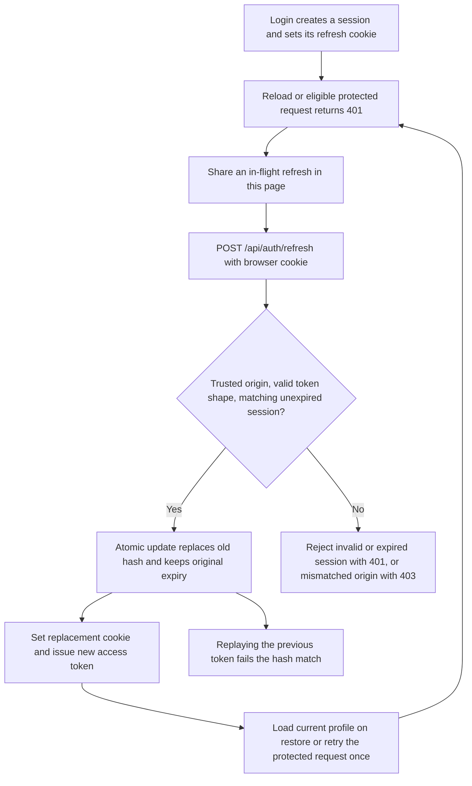
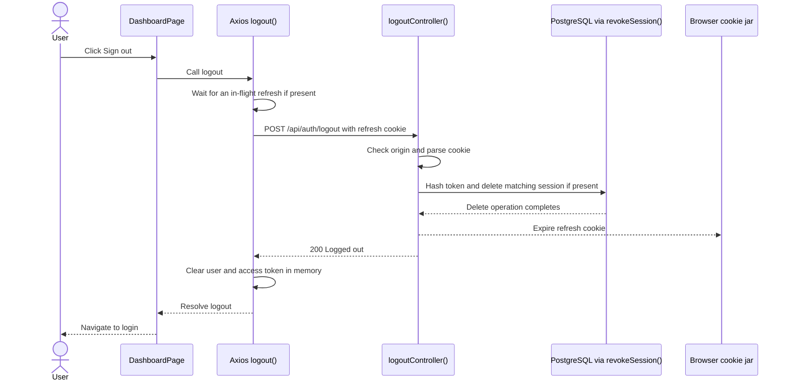

# Nexora frontend authentication guide

Nexora's authentication flow connects a React frontend to an Express API and a PostgreSQL database. This guide follows the code from the first browser render through account creation, sign-in, session restoration, and sign-out. Paths are relative to the repository root. Snippets show relevant portions of the named source files.

## 1. Frontend setup

| Technology | Role in Nexora |
| --- | --- |
| React and React DOM | Build the UI from reusable components. State changes such as a form error or a signed-in user update the relevant parts of the page. |
| Vite | Serves the app during development, transforms TSX and CSS as modules are requested, and bundles the production frontend. Its development proxy also connects the LAN preview to Express. |
| TypeScript | Gives the forms, component props, session snapshot, context, and expected API response shapes compile-time types. Runtime request validation still happens in Express with Zod. |
| Tailwind CSS | Generates utility classes through `@tailwindcss/vite` in [`frontend/vite.config.ts`](../frontend/vite.config.ts). [`frontend/src/styles.css`](../frontend/src/styles.css) loads it with `@import "tailwindcss";`. Custom CSS in the same file supplies the visual identity, while classes such as `grid`, `place-items-center`, and `min-h-svh` handle small layout tasks. |
| React Router | Uses browser history for client-side routing. `BrowserRouter` supplies navigation context and `Routes` matches the URL to the pages defined in `main.tsx`. `Link` changes routes in the browser, `useNavigate()` changes routes after an action, and `Navigate` implements route redirects. |
| Axios | Centralizes the API URL, cookie handling, timeout, Bearer token injection, and the refresh-and-retry policy in one client. Its types describe the JSON payloads the frontend expects. |

### Environment and startup

`frontend/.env` is an optional local configuration file. Vite exposes variables prefixed with `VITE_` to frontend code through `import.meta.env`. The current `frontend/.env.example` shows a commented example of `VITE_API_BASE_URL`. Leave the variable unset to use the development proxy. Set it to an API origin such as `http://localhost:8000` when intentionally connecting directly to that backend. An explicit value takes priority over the proxy. Production bundles use the value available at build time, or fall back to `http://localhost:8000` when it is unset. Restart the development server after changing a local env file. Vite embeds frontend env values in client code, so keep signing keys and database connection strings in the backend environment.

Run these commands from `frontend/`. In Windows PowerShell, `npm.cmd` is an alternative if execution policy blocks the `npm.ps1` launcher.

```sh
npm ci
npm run dev
```

`npm run dev` starts Vite. Vite reads its plugins and proxy config, serves `index.html`, and loads the `/src/main.tsx` module named in the HTML. React mounts in `#root`. The router selects the screen and the provider begins checking for a session. During development, edits are picked up through Vite's hot module replacement. The backend is a separate process listening on port 8000.

`npm run build` first runs `tsc --noEmit` to type-check the source and config, then runs `vite build` to write the deployable assets to `frontend/dist/`. `npm run preview` serves that build locally. The auth proxy lives under Vite's `server` configuration for development, so a deployed build needs its own routing and API configuration.

## 2. Frontend folder structure

```text
frontend/
├── .env.example
├── index.html
├── package.json
├── package-lock.json
├── tsconfig.json
├── vite.config.ts
└── src/
    ├── main.tsx
    ├── styles.css
    ├── auth/
    │   ├── api.ts
    │   ├── AuthGate.tsx
    │   └── AuthProvider.tsx
    ├── components/
    │   ├── AuthButton.tsx
    │   ├── AuthInput.tsx
    │   ├── AuthLayout.tsx
    │   └── Workflow.tsx
    └── pages/
        ├── AuthPage.tsx
        └── DashboardPage.tsx
```

| File | What it owns and where it connects |
| --- | --- |
| `frontend/index.html` | Sets the initial title, viewport, and theme color, and declares `#root` plus the module entry. |
| `frontend/package.json` and `frontend/package-lock.json` | Declare dependencies and npm scripts, then pin the resolved dependency tree for repeatable installs. |
| `frontend/tsconfig.json` | Enables strict type checking, React JSX, and bundler-style module resolution. It covers `src/` and `vite.config.ts`, with Vite client and Node types. Vite emits the actual browser bundle. |
| `frontend/vite.config.ts` | Registers the React and Tailwind plugins and proxies development requests under `/api/auth` to the backend. |
| `frontend/.env.example` | Documents the optional `VITE_API_BASE_URL` override. |
| `frontend/src/main.tsx` | Calls `createRoot()` and assembles `StrictMode`, `BrowserRouter`, `AuthProvider`, and the route tree. It imports the fonts and global CSS. This file serves the root composition role often assigned to `App.tsx`. |
| `frontend/src/styles.css` | Imports Tailwind and defines the shell, typography, form controls, workflow animation, breakpoints, and reduced-motion rules. |
| `frontend/src/auth/api.ts` | Acts as both the frontend auth service and the shared session store. It creates the Axios client, manages login/signup/logout requests, implements `restoreSession()` and refresh/retry, and formats errors with `authError()`. |
| `frontend/src/auth/AuthProvider.tsx` | Holds the context and startup loading state. It subscribes to `api.ts` and exports the `useAuth()` hook that pages and the route gate use. |
| `frontend/src/auth/AuthGate.tsx` | Reads the context and decides whether to show the loading screen, render an `Outlet`, or redirect. |
| `frontend/src/pages/AuthPage.tsx` | Renders login or signup from its `mode` prop. Owns the form state, client validation, and submit handlers. |
| `frontend/src/pages/DashboardPage.tsx` | Displays the signed-in user's name and email and provides the sign-out form. It is the protected account screen for this implementation. |
| `frontend/src/components/AuthLayout.tsx` | Shares the branded product panel, `Workflow`, and form panel across login and signup. The page supplies the form as `children`. |
| `frontend/src/components/AuthInput.tsx` | Shares labels, icons, accessible validation markup, password visibility, and optional clear-button behavior. |
| `frontend/src/components/AuthButton.tsx` | Gives forms a shared submit button, disabled while busy, with a spinner and an operation-specific loading label. |
| `frontend/src/components/Workflow.tsx` | Renders the example nodes and tracks the selected step. CSS handles the traveling pulse and node glow. |

The route declarations live in `main.tsx`. `AuthGate` handles route policy, `AuthLayout` handles visual layout, `api.ts` houses service functions, and `useAuth()` lives beside its context provider. These responsibilities are represented by the files above.

## 3. Login and signup UI

### Layout, styling, and motion

`AuthPage` wraps the form card in `AuthLayout`. `.auth-shell` creates a two-column grid with the product story and lead-enrichment example on the left and the form on the right. The stylesheet uses near-black purple backgrounds, layered radial gradients, translucent surfaces and borders, soft shadows, and violet-to-cyan accents. `main.tsx` imports Manrope for body text and Space Grotesk for display text. Icons come from `lucide-react`. At 820 px and below, the shell becomes one column. A 420 px breakpoint compacts the workflow nodes for narrow screens.

Motion comes from CSS keyframes. `Workflow` renders four tracks that pulse through Webhook → Enrich lead → Route lead → Sync to CRM → Webhook. `current-x` and `current-y` move the glow along horizontal and vertical tracks. Staggered delays and `node-current` align the card glow with each stage over an 11-second cycle. The pulse plays automatically, and a node button toggles its description in an `aria-live` footer. The workflow is an interactive product example composed of local data and CSS. The card entrance and submit spinner also use CSS animations. `prefers-reduced-motion` disables animations and transitions.

### Inputs, state, and feedback

- `mode` controls the fields. Both pages collect email and password. Signup adds full name, confirmation, and the live password-strength meter.
- Email and password are controlled inputs backed by `useState`. Name and confirmation are read from the DOM with `FormData` on submission. The strength meter scores length, letter case, and numbers or symbols, and displays a label. The meter is feedback. The validation rules decide whether the form may submit.
- `AuthInput` uses `useId()` to associate the label, help text, and error with the input. It adds `aria-invalid` when appropriate. A password action toggles between masked and visible text. The email clear action appears when there is a value, clears it through the parent callback, and restores input focus.
- `AuthPage.submit()` prevents normal HTML form navigation and checks `busy`. `noValidate` delegates validation feedback to the React form. Signup checks a trimmed name of 1–100 characters and matching confirmation. Both modes check the trimmed email shape and 254-character limit, a nonempty password, and a 72-byte UTF-8 password limit. Signup adds an eight-character minimum. `TextEncoder` measures bytes because characters and bytes can differ.
- A local validation failure sets field errors, focuses the first invalid input with `requestAnimationFrame()`, and ends the submission before any API call. Editing a field clears its error and the form-level error.
- During a valid submission, `busy` disables the submit button, drives its spinner and label, and sets `aria-busy` on the form. `authError()` reads the usable server error message and known field names. `AuthPage` maps those field names to inline hints and announces the form error with `role="alert"`. A missing response or server failure uses the page's generic fallback. `finally` resets `busy`.
- The two forms share the layout, controls, and state pattern. After validation, signup calls the signup service and navigates to login on success. Login calls the context action and lets the route gate handle the redirect.

## 4. Frontend and backend integration

### The shared client

[`frontend/src/auth/api.ts`](../frontend/src/auth/api.ts) contains the instance used by all five auth endpoints.

```ts
export const api = axios.create({
  baseURL: import.meta.env.VITE_API_BASE_URL || (import.meta.env.DEV ? '/' : 'http://localhost:8000'),
  withCredentials: true,
  timeout: 15_000,
});
```

Axios serializes signup and login objects as JSON. `withCredentials: true` allows credentialed cross-origin requests so the browser can accept and send cookies when policy allows it. With the same-origin dev proxy, the browser handles cookies as first-party cookies. `withCredentials` does not mint credentials or override cookie attributes, CORS rules, or browser cookie policy. `GET /api/auth/me` uses a separate credential, the Bearer access token.

### The development proxy and CORS

A phone opening `http://<dev-machine-ip>:5173/signup` sees the development machine as the frontend host. A browser request to `localhost:8000` from that phone targets the phone. Even from the development computer, a LAN-address page and a localhost API have different origins, and the default backend CORS origin is `http://localhost:5173`.

With the dev base URL of `/`, Axios sends `/api/auth/...` to the Vite origin the browser is already using. [`frontend/vite.config.ts`](../frontend/vite.config.ts) forwards that path to `http://localhost:8000` **from the development machine**. The browser sees the response and cookies on the preview origin. The proxy forwards the existing path intact.

The `proxyReq` callback changes the outbound `Origin` to `http://localhost:5173` only when the incoming origin equals `http://` plus the incoming `Host`. An origin from another site stays unchanged for Express to check. Refresh and logout use `isTrustedAuthOrigin()` to accept the configured frontend origin or a request with an absent `Origin` header, and reject a different supplied origin with 403. This dev proxy assumes the backend accepts `http://localhost:5173`. Setting `VITE_API_BASE_URL` to a full URL sends the browser directly to that API and bypasses the proxy.

[`backend/src/app.ts`](../backend/src/app.ts) registers the middleware in this order.

```ts
app.use(cors({ origin: frontendOrigin || false, credentials: true }));
app.use(express.json());
// Health routes are registered here in the full source.
app.use('/api/auth', authRouter);
```

`frontendOrigin` comes from `FRONTEND_ORIGIN` in [`backend/src/config/env.ts`](../backend/src/config/env.ts). It defaults to `http://localhost:5173` outside production and is undefined in production when unset. The CORS middleware supplies the configured origin and credential headers for browser requests. CORS controls browser access to cross-origin responses. The Bearer middleware and cookie endpoint origin checks enforce their own policies on the API.

### JSON across the boundary

1. A React handler calls an auth function. Axios sends a method, a URL, and a JSON body for signup or login.
2. Express receives the request on port 8000. `express.json()` populates `req.body` before `authRouter` dispatches to a controller.
3. Controllers validate input or credentials, call service functions, and use `res.status(...).json(...)` to return a status and a JSON object. Login, refresh, and logout can also send `Set-Cookie` headers. `cookie-parser` runs on the refresh and logout routes so the controller can read `req.cookies`.
4. Axios resolves a successful response with `data` and rejects failed HTTP statuses. The form shows errors or updates the UI using the data. The browser processes `Set-Cookie` independently of the JSON body.

## 5. Signup flow

1. **React form** — `AuthPage.submit()` in [`frontend/src/pages/AuthPage.tsx`](../frontend/src/pages/AuthPage.tsx) validates the inputs and calls `register({ name, email, password: secret })`. `register` is the imported alias for `signup()` from `frontend/src/auth/api.ts`. The confirmation field is consumed by React alone.
2. **Axios and routing** — `signup()` sends `POST /api/auth/signup`. `backend/src/app.ts` mounts `authRouter` at `/api/auth`, and [`backend/src/routes/auth.routes.ts`](../backend/src/routes/auth.routes.ts) maps `/signup` to `signupController`.
3. **Controller and Zod** — `signupController()` calls `signupSchema.safeParse(req.body)`. [`backend/src/validators/auth.validator.ts`](../backend/src/validators/auth.validator.ts) trims the name, trims and lowercases the email, then validates the name, email, and password limits. It measures the 72-byte password cap with `Buffer.byteLength()`. On invalid data the controller sends `400` with `{ error: 'Invalid signup input', fields }`. Valid parsed input goes to the backend `signup()` function.
4. **Service, hashing, and database** — [`backend/src/services/auth.service.ts`](../backend/src/services/auth.service.ts) queries the users table by `lower(email)`. It throws `DuplicateEmailError` if a match exists. It then hashes the password using bcryptjs with a cost of 12 and inserts through Drizzle. [`backend/src/config/db.ts`](../backend/src/config/db.ts) binds Drizzle to a `pg` connection pool. PostgreSQL enforces the unique `users_email_unique` index on `lower(email)` even when two requests reach the insert at the same time. The service maps PostgreSQL code `23505` for that specific index to `DuplicateEmailError`.
5. **Response and React navigation** — The controller maps a duplicate to `409 Email already registered` and unexpected failures to a generic `500`. On success it returns HTTP `201` with only `id`, `name`, and `email`. The frontend replaces the current route with `/login` and sets `signupComplete: true` in router state. The login page reads that flag and displays “Account created. You can now sign in.” The user gets a session by signing in next.

The insert uses a restricted return projection, so the password hash stays in PostgreSQL.

```ts
const passwordHash = await hash(password, 12);
// Inside the service's insert try block
const [user] = await db.insert(users)
  .values({ name, email, passwordHash })
  .returning({ id: users.id, name: users.name, email: users.email });
```

## 6. Login flow

1. `AuthPage.submit()` sends email and password through `useAuth().login`. The provider delegates to `login()` in `frontend/src/auth/api.ts`, which posts to `/api/auth/login`.
2. `loginController()` calls `loginSchema.safeParse()`. The login schema shares email normalization and the password byte limit with signup. Login accepts any nonempty password within the byte limit for verification. Invalid input returns `400 Invalid login input`.
3. Backend `login()` looks up the normalized email and calls bcrypt's `compare()` with the stored hash. For an unknown email it still does a bcrypt comparison using a fixed dummy hash to make the failure paths do comparable work. Both a missing user and a wrong password lead to `401 Invalid email or password`. A valid login yields a public user object.
4. The controller calls `signAccessToken(user.id)` and `createSession(user.id)`. The JWT contains the user ID as its subject. The new session stores a hash of a separately generated refresh token, associated with that user in PostgreSQL.
5. `setRefreshCookie()` places the raw refresh token in a `Set-Cookie` header for `nexora_refresh`. Express sends `Cache-Control: no-store` and HTTP `200` with the public user fields and `accessToken` in JSON. Unexpected errors get a generic `500`.
6. Axios reads the JSON. The frontend increments `generation` and calls `setSession(token, { id, name, email })`. The provider observes this snapshot update. On `/login`, `AuthGate` sees a user and redirects to `/dashboard`. The dashboard can render immediately from the login response. Startup restoration uses `/me` to load the profile.

From [`backend/src/controllers/auth.controller.ts`](../backend/src/controllers/auth.controller.ts), the success path is:

```ts
const accessToken = signAccessToken(user.id);
const { token, expiresAt } = await createSession(user.id);
setRefreshCookie(res, token, expiresAt);
res.set('Cache-Control', 'no-store').status(200).json({ ...user, accessToken });
```

## 7. AuthProvider and authentication state

Forms, route guards, and the account page all need a consistent view of authentication. [`frontend/src/auth/AuthProvider.tsx`](../frontend/src/auth/AuthProvider.tsx) exposes that view through React Context. `main.tsx` mounts the provider around the entire route tree.

The underlying `session` snapshot lives at module scope in `frontend/src/auth/api.ts` and contains `{ accessToken, user }`. Axios interceptors can read it outside the React tree. `setSession()` replaces the snapshot and notifies the listeners registered through `subscribeSession()`. The provider subscribes with `useSyncExternalStore` so the same change becomes visible to React consumers.

```tsx
const [loading, setLoading] = useState(true);
const session = useSyncExternalStore(auth.subscribeSession, auth.readSession);

// Provider value in the rendered tree
<AuthContext.Provider value={{ ...session, loading, login: auth.login, logout: auth.logout }}>
  {children}
</AuthContext.Provider>
```

A component calls `useAuth()` to access `user`, `accessToken`, `loading`, `login`, or `logout`. The hook reads the context and throws a clear error if used outside the provider. `AuthGate` uses `user` and `loading`. `AuthPage` uses `login`, and `DashboardPage` displays `user` and calls `logout`.

The token lives in memory for the life of the loaded page. A reload clears the JavaScript snapshot. Browser persistence for session restoration comes from the HttpOnly refresh cookie. Keeping the access token out of local storage and session storage avoids leaving a durable copy there. JavaScript in the running frontend can still access the in-memory token. HttpOnly applies to the refresh cookie.

App startup loading and form loading serve different purposes. Provider `loading` covers session restoration. Its effect settles the flag on either outcome, and an `active` guard keeps a discarded effect from setting state. Forms use their own `busy` state and display action errors. On a failed startup restore, the route gate can render the signed-out route once the check finishes. Failed signup, login, or logout operations give feedback at the affected form.

## 8. JWT, refresh tokens, and sessions

| Credential | Format and lifetime | Where it goes |
| --- | --- | --- |
| Access token | JWT signed with HS256, with a user UUID in `sub`, a random UUID in `jti`, and a 15-minute expiration. | The frontend receives it in login or refresh JSON, keeps it in memory, and sends it as `Authorization: Bearer <access-token>` on requests marked `requiresAuth`. |
| Refresh token | An opaque value generated from 32 random bytes and encoded as base64url. The session expires seven days after creation by default. | The browser holds the raw value in `nexora_refresh`. PostgreSQL holds its SHA-256 hash. Refresh and logout use the cookie to find the matching session. |

[`backend/src/services/access-token.service.ts`](../backend/src/services/access-token.service.ts) provides `signAccessToken()` and `verifyAccessToken()`. It requires a signing secret with at least 32 bytes after trimming when checking its length. The verifier restricts the algorithm to HS256, checks expiration through `jsonwebtoken`, requires a numeric `exp`, and validates the subject as a UUID. The 15-minute limit reduces how long a copied access token is usable. Refresh lets a valid browser session continue across those short access-token lifetimes.

[`backend/src/db/schema.ts`](../backend/src/db/schema.ts) and the migration under `backend/drizzle/` define the storage:

- `users` holds the UUID, name, normalized email for users created through signup, bcrypt password hash, and creation and update timestamps. Its case-insensitive email index supports the service's identity lookup.
- `sessions` holds a UUID, `user_id`, unique `refresh_token_hash`, `expires_at`, and `created_at`. A foreign key links the session to the user and cascades deletion when the user is deleted. Multiple rows can belong to one user.
- bcrypt is appropriate for user-chosen passwords because the work factor makes guesses expensive. SHA-256 is used for lookup of an independently generated, high-entropy refresh token. The hash gives the service a stable lookup key without storing the value that the browser presents.

### Cookie and rotation

`nexora_refresh` uses `HttpOnly` so page scripts cannot read it with `document.cookie`. The browser can still attach it to qualifying HTTP requests. The cookie uses `SameSite=Lax`, `Path=/api/auth`, `Secure` when `NODE_ENV=production`, and an expiration matching the database session. The controller also clears an older cookie path, `/api/auth/refresh`, when it sets or clears the current cookie. `REFRESH_TOKEN_DAYS` in the backend environment configures the absolute session lifetime from 1 to 365 days, with 7 as the default.

`rotateSession()` in [`backend/src/services/session.service.ts`](../backend/src/services/session.service.ts) first checks the token's shape. It hashes the presented token and generates a fresh replacement. One database update matches the old hash and requires `expires_at > clock_timestamp()`, then replaces the hash and returns the user ID and original expiration. Putting the match and replacement in one update means that concurrent requests presenting the same old token can update that row only once. A replay sees no match and gets `401`. The successful response sets the new cookie and returns a new access token. Rotation preserves the session row and expiration.

## 9. Automatic session restoration and retries

| Event | What happens |
| --- | --- |
| Successful login | The browser accepts the login cookie. Axios puts the access token and public profile into the snapshot. The route gate can open `/dashboard` immediately. |
| Browser reload | The snapshot starts empty. `AuthProvider` calls `restoreSession()`, which requests `POST /api/auth/refresh` with the browser cookie. If accepted, it stores the new access token and calls `GET /api/auth/me` with that token. It stores the resulting user and finishes loading. A missing or expired session produces `401` on refresh and leaves the app signed out. |
| Access token expires during use | The next eligible protected request that receives `401` can trigger a refresh. The frontend uses the response status as the trigger. Time-based renewal is handled on demand by this interceptor. |
| Several eligible requests receive `401` together | They share `refreshing`, a single in-flight promise in the module. One cookie rotation supplies a replacement token to the callers. A delayed `401` for an older token can use the already-updated token without starting another refresh. |

The two promise variables have different roles. `restoring` deduplicates the startup sequence of refresh plus `/me`. React StrictMode can run a development effect setup, cleanup, and setup again. Both setups share the same pending restoration. The cleanup makes the first effect inactive, and the second effect can finish the loading state. `refreshing` deduplicates just the token refresh, both during startup and when protected requests fail together. These promises are scoped to the current page's module instance. Across separate tabs, the database's conditional update is what enforces one successful use of each refresh token.

The request interceptor attaches the Bearer token to requests with `requiresAuth: true` and records `authGeneration`. The response interceptor checks for `401` on a protected request in the current generation, with a token originally sent and no logout underway. It marks the config with `authRetried` and retries once. Signup, login, refresh, and logout requests omit `requiresAuth` and are outside this retry policy. When a second `401` rejects the still-current token, the client clears its snapshot. A `401` from refresh itself also clears the snapshot. Other refresh failures propagate. Login and successful logout increment the generation, so requests from a previous session cannot be retried as the newly signed-in user.

The core branch in `frontend/src/auth/api.ts` reuses a newer token when one is already available:

```ts
config.authRetried = true;
if (usedCurrentToken && !await refreshAccessToken()) throw error;
return api.request(config);
```

## 10. Protected routes and the current user

[`frontend/src/auth/AuthGate.tsx`](../frontend/src/auth/AuthGate.tsx) decides what the browser renders:

| Route group | While restoring | Signed out | Signed in |
| --- | --- | --- | --- |
| `/login` and `/signup` | “Checking your session…” | Render `AuthPage` via `Outlet` | Redirect to `/dashboard` |
| `/dashboard` | “Checking your session…” | Redirect to `/login` | Render `DashboardPage` via `Outlet` |

The route tree in `main.tsx` places the dashboard under `<AuthGate protectedRoute />`. Login and signup use `<AuthGate />`. The root path redirects to `/login` and then follows the same gate. Redirects use `replace` in browser history.

The frontend gate controls the page experience. The API independently verifies requests. `GET /api/auth/me` runs `requireAuth()` from [`backend/src/middleware/require-auth.ts`](../backend/src/middleware/require-auth.ts). It extracts the Bearer token and calls `verifyAccessToken()`. If verification succeeds, it sets `res.locals.userId` and calls `next()`. Invalid or missing credentials get `401`. `meController()` then calls `findUserById()` in the backend auth service. The Drizzle query selects only `id`, `name`, and `email`. A missing user gets `401`. This database lookup gives the browser the current profile rather than relying on profile data embedded in a token.

## 11. Logout flow

1. In `DashboardPage`, the **Sign out** button submits the form. The handler calls `useAuth().logout()` and shows a loading label during the operation.
2. Frontend `logout()` sets `loggingOut` and waits for an existing refresh to finish so the browser can receive its cookie update first. Then it calls `POST /api/auth/logout` with the cookie.
3. Express dispatches through `cookie-parser` to `logoutController()`. That controller checks the origin and passes the refresh cookie to `revokeSession()`. The service validates the token shape, hashes it, and deletes the row with the matching `refresh_token_hash`.
4. The controller clears the cookie using the same attributes and clears the legacy-path copy. Success is `200` with `{ message: 'Logged out' }` and a no-store header. An absent cookie, invalid format, or already-deleted session also produces a successful logout. The deletion targets that session alone.
5. After the response, the frontend increments `generation`, clears the snapshot, and navigates to `/login` with history replacement. The dashboard gate now redirects if visited without a session. On a failed logout request, the dashboard shows an error and allows another attempt.

Logout revokes the database-backed refresh session. A previously issued access token can remain valid until its 15-minute expiration, because `requireAuth()` verifies the JWT signature and claims independently of the session row. The frontend discards its access token after a successful logout.

## 12. Issues we encountered and how to verify the fix

| Issue | Cause and resolution |
| --- | --- |
| Login and signup began as placeholder screens | The polished flow was built around a shared `AuthLayout`, `AuthPage`, reusable inputs and button, and the interactive workflow card. Separate route entries select the form mode. |
| The UI originally stopped at preview feedback | At that stage, client-side inputs and validation ran without submitting to Express. The integration wired the form handlers to Axios, added context and route gates, and connected cookie-backed restore and logout. |
| Signup on the Wi-Fi preview showed a generic failure | The browser was targeting `localhost:8000` directly. On a second device that points to the device itself. On the development machine, the Wi-Fi frontend origin also differs from the backend's default allowed origin. The dev default now sends relative auth URLs to Vite, and Vite forwards them to Express locally. |
| Backend startup failed when `DATABASE_URL` was missing | The app reads `backend/.env` or the process environment. The root Compose env and the backend env are separate locations. `config/db.ts` stops startup when the setting is absent. The local fix was to supply `DATABASE_URL` through the backend env and verify the database health endpoint. |
| Logout needed the same refresh cookie as refresh | The original cookie path `/api/auth/refresh` limited where the browser could send it. The current path is `/api/auth`, so refresh and logout both receive it. The controller clears the older path to support the transition. |

### Local browser walkthrough

Use a development database with the migrations applied. `docker-compose.yml` defines the local PostgreSQL service and maps host port 5433 to container port 5432. The migration scripts are defined in `backend/package.json`, and `backend/drizzle.config.ts` points to the schema and migration directory. For an initial local setup, start PostgreSQL, supply the backend's own `DATABASE_URL` and `JWT_ACCESS_SECRET`, run `npm run db:migrate` from `backend/`, then run `npm run dev` there. Check `http://localhost:8000/api/health` for Express and `http://localhost:8000/api/db-health` for database connectivity. The second runs `SELECT 1` and returns 503 if that query fails.

1. Run `npm run dev` from `frontend/` and open `http://localhost:5173/signup`. For a local Wi-Fi preview, start Vite with `npm run dev -- --host 0.0.0.0` and open the displayed network URL on a device on the same LAN. Leave the API override unset to exercise the proxy and keep the backend on port 8000.
2. Submit signup with mismatched confirmation and use DevTools **Network** to confirm that the browser does not send signup. Correct the values, use a fresh test email, and confirm a `201`, navigation to `/login`, and the success message. The request body contains `name`, `email`, and `password`.
3. Try a wrong password and check for `401` and the generic credentials message. Sign in correctly and confirm `/dashboard`. In DevTools **Application** or **Storage**, check the presence and HttpOnly attribute of `nexora_refresh`. The access token is held in memory.
4. Reload `/dashboard`. Filter Network requests to `/api/auth` and look for one startup refresh followed by `/me`. The dashboard should remain available once restoration completes. While signed in, opening `/login` or `/signup` should take you back to the dashboard.
5. Select **Sign out**. Expect a successful logout, a cleared cookie, and a redirect to `/login`. Visit `/dashboard` again to confirm that it redirects to login. Keep cookie values, request passwords, and access tokens out of screenshots and shared logs.

**Verification scope.** Earlier local integration checks passed the production build and exercised signup, validation and login errors, protected redirects, StrictMode startup restoration, concurrent `401` retries, and logout in Chrome. The auth flow was also exercised through the Wi-Fi preview address. The retry check injected protected-request `401` responses. It exercised the retry path without waiting 15 minutes for a token to age out. The guide describes the inspected source and local setup. Production deployment behavior depends on the host's HTTPS, frontend origin, cookie policy, API configuration, and SPA routing.

## 13. Complete architecture

### Frontend, backend, and database



The cookie is managed by the browser's HTTP layer. The dotted connection represents credentialed requests and responses, with JavaScript using Axios to initiate requests.

### Signup sequence



### Login and JWT sequence



### Refresh-token lifecycle



### Logout sequence


